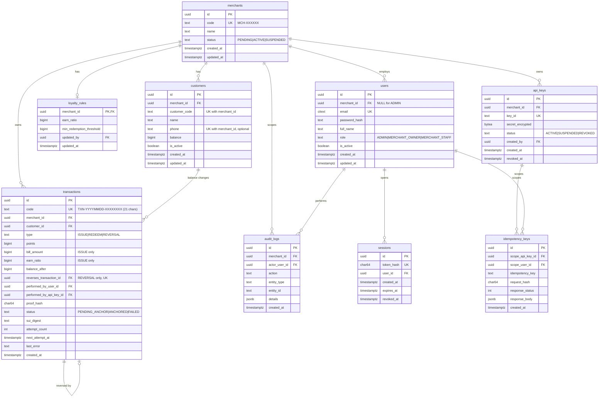

# OctaPoint – Database Schema (PostgreSQL 16+)

Source of truth: SRS (`PROJECT_REPORT_FIXED.md`). This file turns the SRS rules into tables and constraints. If this file and the SRS disagree, the SRS wins and this file must be fixed.

Conventions
- All ids are `uuid` (`gen_random_uuid()`), all times are `timestamptz` stored in UTC.
- Points, amounts and balances are `bigint` (never floating point).
- Enum-like columns use `text` + `CHECK`. DB values are UPPERCASE (`PENDING`, `ACTIVE`, `SUSPENDED`); the UI shows them as `Pending`, `Active`, `Suspended`.
- Business rules that must hold under concurrency are enforced **in the database** (CHECK, UNIQUE, triggers), not only in code (BR-05, BR-06, BR-21).

## 1. ERD



## 2. Tables

```sql
CREATE EXTENSION IF NOT EXISTS citext;

-- FE2 / BR-18
CREATE TABLE merchants (
  id         uuid PRIMARY KEY DEFAULT gen_random_uuid(),
  code       text NOT NULL UNIQUE CHECK (code ~ '^MCH-[A-Z0-9]{6}$'),          -- CR-05
  name       text NOT NULL,
  status     text NOT NULL DEFAULT 'PENDING' CHECK (status IN ('PENDING','ACTIVE','SUSPENDED')),
  created_at timestamptz NOT NULL DEFAULT now(),
  updated_at timestamptz NOT NULL DEFAULT now()
);

-- FE1 / BR-02. Email is globally unique because login uses email only (MSG31).
CREATE TABLE users (
  id            uuid PRIMARY KEY DEFAULT gen_random_uuid(),
  merchant_id   uuid REFERENCES merchants(id),
  email         citext NOT NULL UNIQUE,
  password_hash text NOT NULL,                                                  -- BCrypt
  full_name     text NOT NULL,
  role          text NOT NULL CHECK (role IN ('ADMIN','MERCHANT_OWNER','MERCHANT_STAFF')),
  is_active     boolean NOT NULL DEFAULT true,
  created_at    timestamptz NOT NULL DEFAULT now(),
  updated_at    timestamptz NOT NULL DEFAULT now(),
  CHECK ((role = 'ADMIN') = (merchant_id IS NULL))                             -- Admin has no merchant
);
CREATE UNIQUE INDEX uq_one_owner_per_merchant ON users(merchant_id) WHERE role = 'MERCHANT_OWNER';

-- BR-19. The cookie holds a random token; only its SHA-256 hash is stored.
CREATE TABLE sessions (
  id         uuid PRIMARY KEY DEFAULT gen_random_uuid(),
  token_hash char(64) NOT NULL UNIQUE,
  user_id    uuid NOT NULL REFERENCES users(id),
  created_at timestamptz NOT NULL DEFAULT now(),
  expires_at timestamptz NOT NULL,                                              -- created_at + 8 hours
  revoked_at timestamptz
);
CREATE INDEX ix_sessions_user ON sessions(user_id);

-- FE4 / BR-07. No row = rules not set (MSG32, BR-22).
CREATE TABLE loyalty_rules (
  merchant_id             uuid PRIMARY KEY REFERENCES merchants(id),
  earn_ratio              bigint NOT NULL CHECK (earn_ratio BETWEEN 1 AND 1000000),            -- VND per point
  min_redemption_threshold bigint NOT NULL CHECK (min_redemption_threshold BETWEEN 1 AND 1000000), -- points
  updated_by              uuid NOT NULL REFERENCES users(id),
  updated_at              timestamptz NOT NULL DEFAULT now()
);

-- FE6 / BR-08 / CR-07
CREATE TABLE api_keys (
  id               uuid PRIMARY KEY DEFAULT gen_random_uuid(),
  merchant_id      uuid NOT NULL REFERENCES merchants(id),
  key_id           text NOT NULL UNIQUE,            -- public id sent in X-API-Key, e.g. oct_<32 hex>
  secret_encrypted bytea NOT NULL,                  -- AES-256-GCM: 12-byte nonce || ciphertext || 16-byte tag
  status           text NOT NULL DEFAULT 'ACTIVE' CHECK (status IN ('ACTIVE','SUSPENDED','REVOKED')),
  created_by       uuid NOT NULL REFERENCES users(id),
  created_at       timestamptz NOT NULL DEFAULT now(),
  revoked_at       timestamptz
);
CREATE INDEX ix_api_keys_merchant ON api_keys(merchant_id, status);
-- Max 5 keys with status ACTIVE or SUSPENDED per merchant: enforced in the service inside a
-- transaction that first locks the merchant row (SELECT ... FOR UPDATE), then counts, then inserts (MSG40).

-- FE3 / BR-04 / BR-05 / BR-16
CREATE TABLE customers (
  id            uuid PRIMARY KEY DEFAULT gen_random_uuid(),
  merchant_id   uuid NOT NULL REFERENCES merchants(id),
  customer_code text NOT NULL CHECK (customer_code ~ '^[A-Z0-9]{1,32}$'),
  name          text NOT NULL,
  phone         text CHECK (phone ~ '^0[0-9]{9}$'),                              -- optional
  balance       bigint NOT NULL DEFAULT 0 CHECK (balance >= 0 AND balance <= 1000000000),
  is_active     boolean NOT NULL DEFAULT true,
  created_at    timestamptz NOT NULL DEFAULT now(),
  updated_at    timestamptz NOT NULL DEFAULT now(),
  UNIQUE (merchant_id, customer_code),                                           -- BR-04
  UNIQUE (id, merchant_id)                                                       -- lets transactions prove same-merchant
);
CREATE UNIQUE INDEX uq_customer_phone ON customers(merchant_id, phone) WHERE phone IS NOT NULL;   -- MSG38
-- customer_code and merchant_id never change after insert (enforced by the service; optional trigger).

-- FE5 / FE8 / BR-03 / BR-12 / BR-20
CREATE TABLE transactions (
  id                        uuid PRIMARY KEY DEFAULT gen_random_uuid(),
  code                      text NOT NULL UNIQUE CHECK (code ~ '^TXN-[0-9]{8}-[A-Z0-9]{8}$'),   -- CR-05, also the on-chain id
  merchant_id               uuid NOT NULL REFERENCES merchants(id),
  customer_id               uuid NOT NULL,
  type                      text NOT NULL CHECK (type IN ('ISSUE','REDEEM','REVERSAL')),
  points                    bigint NOT NULL CHECK (points BETWEEN 1 AND 1000000),          -- CR-02 ceiling per request
  bill_amount               bigint CHECK (bill_amount BETWEEN 1 AND 1000000000),   -- ISSUE only
  earn_ratio                bigint CHECK (earn_ratio BETWEEN 1 AND 1000000),       -- ISSUE only (rule snapshot)
  balance_after             bigint NOT NULL CHECK (balance_after >= 0),
  reverses_transaction_id   uuid REFERENCES transactions(id),                      -- REVERSAL only
  performed_by_user_id      uuid REFERENCES users(id),
  performed_by_api_key_id   uuid REFERENCES api_keys(id),
  proof_hash                char(64) NOT NULL,                                     -- see section 4
  status                    text NOT NULL DEFAULT 'PENDING_ANCHOR'
                            CHECK (status IN ('PENDING_ANCHOR','ANCHORED','FAILED')),
  sui_digest                text,
  attempt_count             int  NOT NULL DEFAULT 0,                               -- anchoring retry fields (BR-03); counts only non-temporary failures (anchoring.md section 3)
  next_attempt_at           timestamptz NOT NULL DEFAULT now(),
  last_error                text,
  created_at                timestamptz NOT NULL DEFAULT date_trunc('milliseconds', now()),  -- the API passes this value explicitly (section 4); the default is only a fallback
  FOREIGN KEY (customer_id, merchant_id) REFERENCES customers(id, merchant_id),    -- BR-01
  CONSTRAINT chk_type_fields CHECK (
       (type = 'ISSUE'    AND bill_amount IS NOT NULL AND earn_ratio IS NOT NULL AND reverses_transaction_id IS NULL)
    OR (type = 'REDEEM'   AND bill_amount IS NULL AND earn_ratio IS NULL AND reverses_transaction_id IS NULL)
    OR (type = 'REVERSAL' AND bill_amount IS NULL AND earn_ratio IS NULL AND reverses_transaction_id IS NOT NULL)),
  CONSTRAINT chk_actor  CHECK ((performed_by_user_id IS NOT NULL)::int + (performed_by_api_key_id IS NOT NULL)::int = 1),
  CONSTRAINT chk_digest CHECK ((status = 'ANCHORED') = (sui_digest IS NOT NULL))
);
-- BR-21: an original can be reversed only once.
CREATE UNIQUE INDEX uq_one_reversal ON transactions(reverses_transaction_id) WHERE type = 'REVERSAL';
CREATE INDEX ix_tx_merchant_time ON transactions(merchant_id, created_at DESC, id DESC);
CREATE INDEX ix_tx_customer_time ON transactions(customer_id, created_at DESC, id DESC);
CREATE INDEX ix_tx_anchor_queue  ON transactions(next_attempt_at) WHERE status = 'PENDING_ANCHOR';

-- BR-10
CREATE TABLE idempotency_keys (
  id               uuid PRIMARY KEY DEFAULT gen_random_uuid(),
  scope_api_key_id uuid REFERENCES api_keys(id),     -- external API calls: scope = API key
  scope_user_id    uuid REFERENCES users(id),        -- portal calls: scope = logged-in user
  idempotency_key  text NOT NULL CHECK (char_length(idempotency_key) BETWEEN 1 AND 128),
  request_hash     char(64) NOT NULL,                -- SHA-256 hex of method + '.' + path-with-query + '.' + sha256_hex(raw body)
  response_status  int NOT NULL,
  response_body    jsonb NOT NULL,
  created_at       timestamptz NOT NULL DEFAULT now(),
  CHECK ((scope_api_key_id IS NOT NULL)::int + (scope_user_id IS NOT NULL)::int = 1)
);
CREATE UNIQUE INDEX uq_idem_api  ON idempotency_keys(scope_api_key_id, idempotency_key) WHERE scope_api_key_id IS NOT NULL;
CREATE UNIQUE INDEX uq_idem_user ON idempotency_keys(scope_user_id,    idempotency_key) WHERE scope_user_id    IS NOT NULL;

-- CR-04. Stored in the database only (LI-03).
CREATE TABLE audit_logs (
  id          uuid PRIMARY KEY DEFAULT gen_random_uuid(),
  merchant_id uuid REFERENCES merchants(id),
  actor_user_id uuid REFERENCES users(id),
  action      text NOT NULL,   -- RULE_UPDATED, API_KEY_CREATED, API_KEY_REVOKED, MERCHANT_APPROVED,
                               -- MERCHANT_SUSPENDED, STAFF_CREATED, STAFF_DEACTIVATED, CUSTOMER_DEACTIVATED, CUSTOMER_REACTIVATED,
                               -- PASSWORD_CHANGED, REVERSAL_CREATED
  entity_type text NOT NULL,
  entity_id   text NOT NULL,
  details     jsonb NOT NULL DEFAULT '{}',
  created_at  timestamptz NOT NULL DEFAULT now()
);
CREATE INDEX ix_audit_merchant_time ON audit_logs(merchant_id, created_at DESC);
```

## 3. Ledger protection (BR-03, BR-21)

```sql
-- Only status, sui_digest and the retry fields may change. No deletes, no truncate.
CREATE FUNCTION transactions_guard() RETURNS trigger LANGUAGE plpgsql AS $$
BEGIN
  IF TG_OP = 'DELETE' THEN
    RAISE EXCEPTION 'transactions are immutable (BR-03)';
  END IF;
  IF ROW(NEW.id, NEW.code, NEW.merchant_id, NEW.customer_id, NEW.type, NEW.points, NEW.bill_amount,
         NEW.earn_ratio, NEW.balance_after, NEW.reverses_transaction_id, NEW.performed_by_user_id,
         NEW.performed_by_api_key_id, NEW.proof_hash, NEW.created_at)
     IS DISTINCT FROM
     ROW(OLD.id, OLD.code, OLD.merchant_id, OLD.customer_id, OLD.type, OLD.points, OLD.bill_amount,
         OLD.earn_ratio, OLD.balance_after, OLD.reverses_transaction_id, OLD.performed_by_user_id,
         OLD.performed_by_api_key_id, OLD.proof_hash, OLD.created_at) THEN
    RAISE EXCEPTION 'transaction fields are immutable (BR-03)';
  END IF;
  IF OLD.status IN ('ANCHORED','FAILED') AND (NEW.status, NEW.sui_digest) IS DISTINCT FROM (OLD.status, OLD.sui_digest) THEN
    RAISE EXCEPTION 'ANCHORED and FAILED are final states (LI-08)';
  END IF;
  RETURN NEW;
END $$;
CREATE TRIGGER trg_transactions_guard BEFORE UPDATE OR DELETE ON transactions
  FOR EACH ROW EXECUTE FUNCTION transactions_guard();

CREATE FUNCTION transactions_no_truncate() RETURNS trigger LANGUAGE plpgsql AS $$
BEGIN RAISE EXCEPTION 'transactions are immutable (BR-03)'; END $$;
CREATE TRIGGER trg_transactions_no_truncate BEFORE TRUNCATE ON transactions
  FOR EACH STATEMENT EXECUTE FUNCTION transactions_no_truncate();

-- BR-21: a REVERSAL must point to an ISSUE or REDEEM of the same merchant and customer with equal points.
CREATE FUNCTION transactions_check_reversal() RETURNS trigger LANGUAGE plpgsql AS $$
DECLARE o transactions%ROWTYPE;
BEGIN
  IF NEW.type <> 'REVERSAL' THEN RETURN NEW; END IF;
  SELECT * INTO o FROM transactions WHERE id = NEW.reverses_transaction_id;
  IF NOT FOUND OR o.type NOT IN ('ISSUE','REDEEM')
     OR o.merchant_id <> NEW.merchant_id OR o.customer_id <> NEW.customer_id OR o.points <> NEW.points THEN
    RAISE EXCEPTION 'invalid reversal target (BR-21)';
  END IF;
  RETURN NEW;
END $$;
CREATE TRIGGER trg_transactions_check_reversal BEFORE INSERT ON transactions
  FOR EACH ROW EXECUTE FUNCTION transactions_check_reversal();
```

`customers.balance >= 0` (CHECK) plus the row lock in section 5 implements BR-05 and BR-06.

## 4. Proof hash (BR-20)

Computed by the API when the transaction row is created and stored in `proof_hash`. Never recomputed from mutable fields. The API takes the current UTC time in milliseconds **once**, before the INSERT, and uses that same value both as `created_at` in the hash and as the `created_at` column, so the stored row always reproduces its own hash.

1. Build an object with exactly these keys: `transaction_id` (= `transactions.code`), `merchant_id` (= `merchants.id`), `customer_code`, `type`, `points`, `created_at` (ISO 8601 UTC with milliseconds, e.g. `2026-11-01T03:15:42.123Z`) and, **only for REVERSAL**, `reverses_transaction_id` (= the original's `code`).
2. Serialize as JSON with keys sorted alphabetically, no whitespace, UTF-8.
3. `proof_hash` = lowercase hex SHA-256 of those bytes.

Test vector:
```
canonical: {"created_at":"2026-11-01T03:15:42.123Z","customer_code":"CUS001","merchant_id":"3f0c2b8e-6f55-4c1a-9d0e-1a2b3c4d5e6f","points":1500,"transaction_id":"TXN-20261101-K7P2M9QX","type":"ISSUE"}
sha256   : fbf42511ae75ae2327bccf4fe9b4560825f52580379e7eaf8e6d340f649ee2a1
```
`status`, `sui_digest`, balances and retry fields are **not** part of the hash. No personal data is hashed except `customer_code`, which is a merchant-defined code, not a name or phone.

## 5. Transaction patterns

Every point-changing operation runs in **one** database transaction in this order (BR-06):

1. (Idempotency) take `pg_advisory_xact_lock(hashtextextended(scope_id::text || ':' || key, 0))`, then look for a saved row younger than 24 hours. Same `request_hash` → return the saved response and stop. Different hash → MSG34. A row older than 24 hours is deleted and ignored.
2. `SELECT ... FROM customers WHERE merchant_id = $1 AND customer_code = $2 FOR UPDATE` (not found → MSG22; inactive → MSG39).
3. Read `loyalty_rules` (missing → MSG32).
4. Validate (redeem: `points >= min_redemption_threshold` → MSG09, then `balance >= points` → MSG08; issue: `floor(amount / earn_ratio) >= 1` → MSG24; points ≤ 1,000,000 → MSG33; resulting balance ≤ 1,000,000,000 → MSG33).
5. `UPDATE customers SET balance = ...`, `INSERT INTO transactions (...)` with a generated `code` (retry with a new random part on a unique violation of `code`) and the API-generated `created_at` (section 4), compute `proof_hash` from them.
6. (Idempotency) `INSERT INTO idempotency_keys (...)` with the response to be returned.
7. `COMMIT`. If anything fails, everything rolls back, so failed requests leave no idempotency row and the same key can be retried.

Reversal: lock the customer row first, then load the original transaction, check `type IN ('ISSUE','REDEEM')` and that no reversal exists (the unique index is the final guard), apply the opposite amount (reversing an ISSUE when `balance < points` → MSG25; reversing a REDEEM when `balance + points > 1,000,000,000` → MSG41; an inactive customer is allowed), insert the `REVERSAL`.

## 6. Reporting queries

```sql
-- Merchant dashboard (3.2.6.2). "Today" = current date in UTC+7.
SELECT count(*)                         AS total_customers   FROM customers WHERE merchant_id = $1;
SELECT coalesce(sum(balance), 0)        AS circulating       FROM customers WHERE merchant_id = $1;
SELECT count(*) AS today_transactions FROM transactions
 WHERE merchant_id = $1
   AND created_at >= (date_trunc('day', now() AT TIME ZONE 'Asia/Ho_Chi_Minh') AT TIME ZONE 'Asia/Ho_Chi_Minh');

-- Admin dashboard (3.2.6.1): issued = ISSUE minus REVERSAL of ISSUE; redeemed = REDEEM minus REVERSAL of REDEEM.
SELECT
  coalesce(sum(CASE WHEN t.type = 'ISSUE'  THEN t.points END), 0)
- coalesce(sum(CASE WHEN t.type = 'REVERSAL' AND o.type = 'ISSUE'  THEN t.points END), 0) AS points_issued,
  coalesce(sum(CASE WHEN t.type = 'REDEEM' THEN t.points END), 0)
- coalesce(sum(CASE WHEN t.type = 'REVERSAL' AND o.type = 'REDEEM' THEN t.points END), 0) AS points_redeemed
FROM transactions t LEFT JOIN transactions o ON o.id = t.reverses_transaction_id;
```

Consistency check (use in tests): for every customer,
`balance = Σ ISSUE + Σ REVERSAL-of-REDEEM − Σ REDEEM − Σ REVERSAL-of-ISSUE`.

## 7. Migrations and seed

- Plain SQL migration files, numbered `0001_*.sql`, applied in order; never edit an applied migration.
- First Admin account is created by a seed script from environment variables (LI-14); see `config-and-deploy.md`.
- Cleanup job: delete `idempotency_keys` older than 24 hours and expired or revoked `sessions` (daily).
